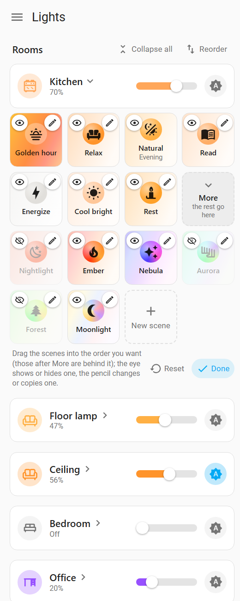
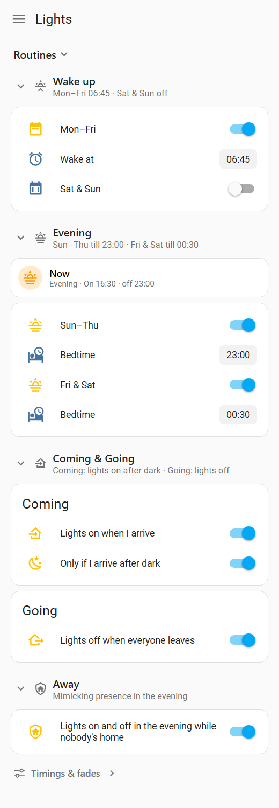
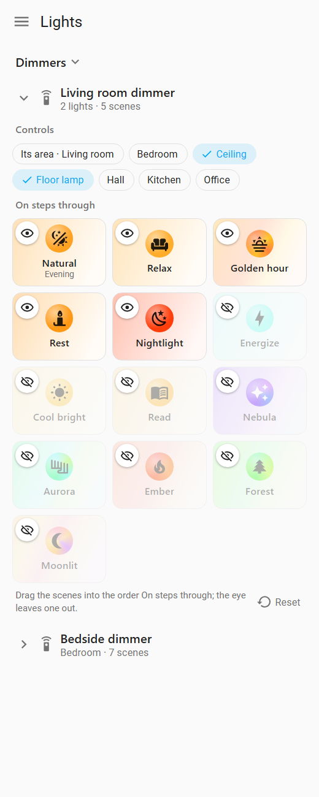

# Hue-Lite

[](https://github.com/Picardas/Hue-Lite/actions/workflows/validate.yml)
[](https://hacs.xyz/docs/faq/custom_repositories/)
[](https://www.home-assistant.io/)
[](LICENSE)

**Philips Hue's lighting behaviour for any lights in Home Assistant, without a
Hue Bridge.** Hue-Lite gives you:
- Hue's scenes, plus a **Natural light** scene that follows the sun.
- Colour scenes that drift slowly.
- An **evening routine**, **wake up**, and **coming and leaving home**.
- **Hue dimmer switches**.
- A **Lights dashboard** that builds itself.

Lights join in by **area** and **label**, with no YAML for each light.

|  |  |  |
| :---: | :---: | :---: |
| Each light's scenes: drag into order, the eye hides one | Wake up, evening, coming & going | Each Hue dimmer's lights and scenes |

<sub>The screenshots show the Lights dashboard with sample lights.</sub>

> [!NOTE]
> **Hue-Lite is vibe-coded.** It was built by prompting an AI coding
> assistant (Claude Code), not written by hand. It runs a real home every
> day and has a test suite that runs on every change. Still, it's a hobby
> project: expect rough edges, and please
> [report them](https://github.com/Picardas/Hue-Lite/issues).

## Features

- **Hue's scenes on any bulb.** Energize, Cool bright, Read, Relax, Rest and
  Nightlight, with Hue's own colours on colour bulbs and a matching colour
  temperature on white ones.
- **Natural light.** One scene that follows the sun: bright and cool in the
  morning, warm in the evening, Rest at night.
- **Colour scenes.** Golden hour, Nebula, Aurora, Ember, Forest and Moonlit.
  Each spreads its colours across a room's bulbs and drifts slowly between
  them.
- **Routines:**
  - The evening routine comes on before sunset and winds down to bedtime.
  - Wake up brings your lights up like a sunrise.
  - Lights come on when you get home and can go off when everyone leaves.
  - Away switches lights on and off in the evening while nobody's home.
- **Dimming that keeps the scene.** Dim a light and it stays in Natural
  light, or its colour scene keeps drifting, at that level.
- **Auto.** One button puts a light under the routines, with or without
  their labels.
- **Hue dimmer switches** (RWL02x on ZHA). On steps through scenes you
  choose; Off, Up and Down work as on Hue.
- **A dashboard that builds itself** from your areas and labels. It's shared
  by every phone and browser, and a card puts any light or room on your other
  dashboards.

## Installation

Hue-Lite needs Home Assistant 2026.10 or later.

**With [HACS](https://hacs.xyz)** (recommended):
1. In HACS, open ⋮ → **Custom repositories**.
2. Add `https://github.com/Picardas/Hue-Lite` as an **Integration**.
3. Download **Hue-Lite**, then restart Home Assistant.

**By hand:** copy `custom_components/hue_lite` into your configuration's
`custom_components/` folder, then restart Home Assistant.

Then go to **Settings → Devices & services → Add integration → Hue-Lite**.
- It asks three things: your home zone, whether to use Hue dimmers, and
  whether to add its Lights dashboard.
- It finds or creates its labels.
- **Configure** changes any of this later.

## Setting up your lights

1. Give each light an **area**.
2. Give it the labels of the routines it should join.

A label counts on the light, its device or its area.

| Label | What it does |
| ----- | ------------ |
| Evening | Joins the evening routine: on before sunset, through the scenes, off at bedtime |
| Wake up | Fades up to Energize at your wake-up time |
| Nightlight | Gets Nightlight instead of Rest overnight and before bed |
| Coming home | Comes on whenever someone gets home |
| First one home | Comes on only for the first person home (when the house was empty), e.g. a bedroom |
| Exclude from lighting | Left out of everything |

Hidden lights and light groups are left out too. Any other label you give
lights becomes a group on the dashboard.

## The Lights dashboard

Reload your browser after setting Hue-Lite up. The first time an admin opens
Home Assistant, Hue-Lite adds a **Lights** dashboard to the sidebar, or uses
one of its own you've already made.
- It's an ordinary dashboard, so you can rename it, move it or make it your
  default.
- If you delete it, it stays deleted. To have it added again, turn **Lights
  dashboard** off and on in Configure.

To make one yourself, create a dashboard and set its raw configuration to:

```yaml
strategy:
  type: custom:hue-lite
```

It rebuilds itself from your areas and labels every time it loads, in this
order:
1. **Whole home**.
2. **Each room.** A room with one light is one block. A room with several
   gets a block for each light, with the room's icon.
3. **Your label groups**.
4. **The routines**, with their settings.
5. **Your dimmers**, if you use them.

**Each block** is a bar over its scenes:
- Tap the icon to switch the light on or off (all of them, for Whole home or
  a label group).
- Slide to dim a single light; it stays in its scene at that level. Whole
  home and label groups have no slider: one brightness for lights in
  different scenes would flatten them.
- **Auto** is at the end of the bar.
- Tap the name to show or hide the scenes.

Icons and sliders take the colour the bulbs report. Each scene tile shows the
colour it gives, and it's filled and ticked while the lights are in that
scene.

**Edit scenes:**
- Drag a block's scene tiles into another order.
- Hide scenes with their eye.

Hue-Lite keeps these, so every phone and browser shows the same.

**Reorder:**
- Drag the rooms into another order. With a finger, hold a moment first; the
  arrow keys work too.
- The order, and which blocks are folded, are each person's own.

**On your other dashboards:**
- Add the **Hue-Lite light** card: Add card → search "Hue-Lite".
- Pick a light, a room or a label group. The card shows that block as it is
  on the Lights dashboard, with the same scenes.

**Home Assistant's own Overview** shows what Natural light and the evening
routine are doing. Hue-Lite's settings are configuration entities, so they're
on the Hue-Lite device page instead.

## How it works

- **Scenes.** Colour bulbs get Hue's colours, white bulbs a colour
  temperature, and dimmable bulbs just the brightness.
- **Colour scenes.**
  - Golden hour, Nebula and Aurora use colours from Hue's own scenes.
  - Ember is deep reds, like firelight. Forest is deep greens. Moonlit is dim
    whites with a touch of colour.
  - A room's colour bulbs show different colours from the scene, each at its
    own brightness, and drift to the next every three minutes. White bulbs
    get a matching white.
- **Natural light** follows the sun:
  1. Energize from dawn.
  2. Cool bright by midday.
  3. Relax at sunset.
  4. Rest at night.

  A light stays in it, on or off, until you pick another scene, change the
  light yourself or from an automation, or use one of your own Home Assistant
  scenes on it.
- **Evening routine:**
  - Before sunset, if someone's home, the Evening lights come on dim and
    brighten.
  - They wind down through Relax and Rest, then fade out at bedtime.
  - Sun–Thu and Fri & Sat nights each have their own switch and bedtime.
- **Dimming.** Dimming a light in a scene, with its slider or a dimmer's Up
  and Down, keeps it there at that level. Natural light keeps following the
  sun and a colour scene keeps drifting, just dimmer or brighter, until you
  pick a scene again.
- **Wake up.** The Wake up lights that are off get a sunrise. They start at
  Nightlight's dim red and fade through orange and warm white, reaching
  Energize at your wake-up time. They can turn off again afterwards.
- **Coming & going:**
  - When someone gets home (optionally only after dark), the Coming home
    lights that are off come on. So do the First one home lights, if the
    house was empty.
  - Evening lights, and lights on Auto, join the evening routine if it's on,
    except in its last half hour or so before bed. The rest come on in
    Natural light.
  - Every light can go off when everyone has left.
- **Away** (off by default). While nobody's home in the evening, from the
  evening routine's start until bedtime, one of the Evening lights switches
  on or off every 10 to 30 minutes, so the house looks lived in.
  - It stops when someone gets home, leaving the lights as they are.
  - At bedtime, it turns off the lights it switched on.
- **Auto** is the button at the end of each bar. A light is on Auto while
  wake up or the evening routine has it, or once you put it on Auto.
  - On Auto, it follows both routines whether or not it has their labels.
  - It stays on Auto, on or off, until you pick a scene for it or change it.
  - Putting a light on Auto matches it to the routines straight away. It
    joins whichever routine is running, or goes off if neither is.
- **Hue dimmers** control their area, or the lights chosen on the Dimmers
  card.
  - **On** steps through their scenes: by default Natural light and the
    presets.
  - **Off** turns the lights off.
  - **Up** and **Down** dim, keeping the lights in their scene.

The settings are switch, time and number entities on the **Hue-Lite** device,
so automations can use them too. `sensor.hue_lite_light_scenes` shows which
scene each light is in.

## Actions

```yaml
action: hue_lite.apply_preset   # energize, cool_bright, read, relax, rest,
target: {area_id: living_room}  # nightlight, golden_hour, nebula, aurora,
data: {preset: relax}           # ember, forest, moonlit
---
action: hue_lite.natural_light  # follow: false takes the lights out instead
target: {label_id: lamps}
---
action: hue_lite.next_scene     # what a dimmer's On button does
target: {area_id: bedroom}
---
action: hue_lite.set_auto       # auto: false takes them off Auto
target: {entity_id: light.hall}
data: {auto: true}
---
action: hue_lite.set_brightness # dims, keeping the lights in their scene
target: {area_id: kitchen}
data: {brightness_pct: 40}
```

With no target, an action uses every light. A user who isn't an admin can
only use it on lights they're allowed to control.

## Limitations

- **Dimmers:** only Hue Dimmer Switches (RWL020, RWL021, RWL022) paired with
  ZHA.
- **Restarts:** a routine whose start falls while Home Assistant is
  restarting is skipped for that day.
- **Dimming from elsewhere:** dimming a light from Home Assistant's own
  light dialog or an automation still takes it out of its scene; only
  Hue-Lite's slider, dimmers and `set_brightness` keep it there.
- **Light groups** are left out, so their members aren't sent commands twice.
  Use areas or labels instead.

## Development

```bash
pip install -r requirements_test.txt
pytest
```

`tests/harness/index.html` renders the dashboard with a mock Home Assistant.
To use it, serve the repository root, e.g. with
`python3 -m http.server --bind 127.0.0.1`, and open `/tests/harness/`.
[AGENTS.md](AGENTS.md) explains how the code is laid out and how to change it.

## Licence

[MIT](LICENSE). Hue-Lite isn't affiliated with or endorsed by Signify or
Philips Hue. Philips Hue is a trademark of Signify.
